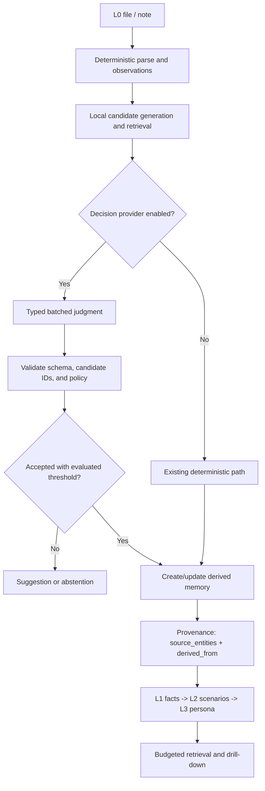

# Local Decision Workflows for MemoPad

**Status:** Design input with partial, read-only service seams implemented.
**Purpose:** Extract reusable workflow patterns from Ollaya, Kev, Nimble, Jevlike,
mini-Jev, jeff, and SemIf, and map them onto MemoPad's existing knowledge pipeline.
The implementation sequence and current stage status are tracked in
[Implementation Roadmap](implementation-roadmap.md).

## Core finding

These projects primarily implement **typed decisions over supplied text and
runtime-defined choices**. They can classify, select, score, and rank. They do
not automatically provide a general-purpose fact-writing or summarization
workflow. MemoPad should preserve deterministic fact creation and use a decision
model only where it can answer a bounded question over a known candidate set.

Keep three concerns separate:

1. **Workflow definition:** what triggers, steps, validation, and guard rails apply.
   MemoPad Skill entities already represent this as versioned knowledge.
2. **Knowledge processing:** deterministic parsing, candidate discovery,
   provenance, deduplication, and persistence. MemoPad already has these seams.
3. **Decision inference:** an optional local provider that answers typed
   questions. It must not write directly to repositories or files.

## Current implementation checkpoint

MemoPad now has a typed `DecisionProvider` protocol and an optional
`LocalSystemOneProvider` transport adapter in
`src/memopad/services/local_decision_provider.py`. The adapter accepts only
loopback HTTP(S) origins, calls a locally running `/v1/systemone`, validates
answers against the request, and exposes transport/protocol failures. It does
not download weights, choose a model, or integrate with application workflows
yet. Composition-root settings, evaluation fixtures, and end-user workflow
integration remain future steps; see the [Implementation Roadmap](implementation-roadmap.md).

`LocalExtractionService` now also has an injectable `suggest_relation_target`
path. It uses MemoPad's existing FTS and alias candidate retrieval, sends only
those candidates plus a bounded source excerpt to the injected local provider,
and accepts either one of those candidate IDs or an explicit `none` choice.
This is a read-only service seam: no public API route uses it yet, and no
relation is persisted. It must remain unwired until the MemoPad-specific
evaluation gate below the roadmap passes.

`ContextService` has a separate optional reranking seam for callers that
explicitly provide a natural-language query. It scores at most 20 already
retrieved primary results and only changes order within groups that share result
type, memory level, and validated-skill status. The existing recall token
budget runs after reranking. Current URI and recent-activity calls do not pass
such a query, no application composition root injects the provider, and no API
or MCP surface exposes reranking. This seam is not enabled pending frozen
MemoPad ranking evaluation.

The implementation is local-only by design. A local server binary may be
free/open-source, but model-weight licenses and local hardware/storage
requirements are independent and must be checked for the chosen model. MemoPad
does not currently send decision requests to hosted providers.

## Patterns worth reusing

| Pattern | Evidence from the projects | MemoPad adaptation |
|---|---|---|
| Typed, runtime-defined decisions | TypeSafe-compatible APIs in Ollaya, Kev, and jeff; direct option-logit experiments in mini-Jev and SemIf | Express each classification, selection, or rating as a validated `choice`, `noul`, or `score` question. Keep the provider transport separate from workflow logic. |
| One shared state, several questions | Kev and Nimble batch questions; SemIf measures shared-state reuse; Ollaya accepts multiple questions in one request | For one note or context, send a bounded batch of independent questions rather than one request per candidate. Treat question isolation and batch-size effects as testable properties. |
| Retrieve before deciding | Candidate scoring works over supplied options; the systems do not replace MemoPad's project-specific graph and alias search | Use FTS, aliases, and existing local search to make a small candidate set first. Ask the model to choose among those candidates, including an explicit abstain option where appropriate. |
| Separate ranking from confidence | mini-Jev and SemIf warn that normalized option scores are conditional and may not be calibrated; Kev and Nimble describe workload-specific calibration | Use scores for ranking unless a held-out MemoPad evaluation supports a confidence threshold. Never interpret a raw candidate share as a universal probability of correctness. |
| No free-form decode for closed choices | mini-Jev, SemIf, and Nimble use direct candidate scoring/logits to avoid generating and parsing JSON | Prefer typed closed-choice output for candidate selection. This does not apply to writing a new fact, explanation, or summary, which requires extraction/generation rather than a decision-only model. |
| Reusable provenance and replay | Nimble emphasizes frozen data, hashes, revisions, and replayable evaluation; SemIf records prompt/model provenance | Preserve source entity and observation references for every derived result. Record provider/model/revision and workflow version when a model contributes, so results can be audited and reproduced. |
| Explicit limits and failure modes | Ollaya documents input limits, queue behavior, and error codes; Kev documents context limits and batching | Bound input size, candidate count, and per-project inference work. Validate every response and expose provider errors; do not silently convert failures into successful-looking suggestions. |
| Evaluate the actual workload | All projects show substantial task- and dataset-dependent results; several explicitly separate ranking, accuracy, calibration, and latency | Build frozen MemoPad task sets and compare against deterministic baselines before enabling any model-assisted writes. Treat published benchmark numbers as project-reported, not predictions of MemoPad performance. |

## MemoPad workflow proposals

### 1. Ingest and distill structured observations

This should remain the reliable backbone for L0-to-L3 knowledge:

1. Ingest or sync the source note as L0 and keep the raw file as ground truth.
2. Parse its observations, relations, and metadata deterministically.
3. Run the existing `FactExtractor` seam over eligible observations. The default
   `CodeExtractor` creates one candidate per distillable structured observation.
4. If an optional decision provider is enabled, use it only for bounded judgments
   over those candidates—for example, whether a candidate is durable enough to
   retain, or which allowed category best fits it.
5. Validate candidate IDs, categories, and output shape. Apply a calibrated
   acceptance/abstention policy; uncertain results remain suggestions.
6. Deduplicate and persist derived L1 facts through `EntityService`, preserving
   `source_entities` and `derived_from` provenance. Keep the operation idempotent.
7. Continue deterministic clustering into L2 and stable aggregation into L3.
   Distilled context remains subject to the existing confidence and token budgets.

**Important boundary:** a Jev-like scorer cannot invent an atomic fact sentence
from arbitrary prose simply by selecting among options. If MemoPad needs to turn
unstructured prose into new text, that is a separate generative extraction
capability with its own protocol, validation, and evaluation. Do not disguise
generation as typed decision inference.

### 2. Suggest relations and tags

1. Parse explicit WikiLinks and mentions locally.
2. Retrieve a bounded set of existing entities through FTS and aliases (and
   embeddings where configured).
3. Ask a typed `choice` question over the candidates plus `none/uncertain`, using
   the note excerpt and mention as state. Batch multiple independent mentions
   when the provider supports it.
4. Return ranked suggestions with the mention, selected entity, and supporting
   source location. Do not persist the relation automatically in the first
   release.
5. After evaluation demonstrates precision on held-out project data, consider an
   explicitly enabled auto-link mode limited to strong, calibrated cases. Record
   how the link was selected and retain an undo path.

This extends, rather than replaces, MemoPad's local relation-extraction work:
candidate discovery remains deterministic and local; the model is not asked to
search the whole knowledge base.

### 3. Rerank context for a query

1. Resolve the project and query as today.
2. Retrieve a bounded candidate pool using existing search and graph signals.
3. Prefer eligible L1/L2/L3 items under the current level/confidence policy;
   retrieve L0 only when explicitly requested or when the workflow calls for
   evidence drill-down.
4. Optionally score/rank a small pool against the query. Keep source references
   and entity levels attached to every candidate.
5. Apply the shared `recall_max_tokens` budget after ranking. A reranker must
   not bypass project isolation, confidence filtering, or provenance.
6. Return the selected compact context and provide `drill_down` to inspect L0
   evidence.

Ranking quality and confidence quality are separate: evaluate Recall@k/MRR or
nDCG for ordering, and separately evaluate Brier/ECE or error-at-coverage for
probability-based thresholds.

### 4. Review possible conflicts

1. Find claims sharing a subject and compatible category or scope using local
   structure; do not generate pairs from vector distance alone.
2. For aligned pairs only, ask a typed decision such as
   `compatible / contradicts / insufficient evidence`.
3. Require explicit evidence spans or source observation IDs from the input
   records; a model answer without traceable inputs is not an actionable alert.
4. Persist a review suggestion, not a conflict mutation, until the threshold and
   false-positive rate are validated.
5. Keep complementary claims such as different technology choices in separate
   scopes from genuine opposites such as mutually exclusive statuses.

### 5. Capture repeatable procedures as Skills

Represent a workflow as a Skill, not as opaque model prompt text:

- `[trigger]`: when the workflow applies.
- `[step]`: ordered deterministic and optional decision steps.
- `[validation]`: observable completion conditions.
- `[when]`, `[do]`, `[don't]`: scope and guard rails.
- `skill_version`, `skill_status`, and `source_entities`: lifecycle and provenance.

MemoPad already provides draft/validated/deprecated status and structural
validation of the trigger-step-validation triple. A Skill can document the
provider/model profile and acceptance policy as metadata, but it should not
contain secrets or become an unreviewed executable instruction. Keep the
workflow's hard invariants in tested code; use Skill content for editable,
versioned procedure and tunables.

## Proposed integration shape

Keep the model boundary behind an injected protocol and use the existing
composition roots for wiring:

```text
MCP / API / scheduler
        |
        v
MemoPad workflow service
  - deterministic candidate retrieval
  - typed question construction
  - output and policy validation
  - provenance / suggestion result
        |
        v
DecisionProvider protocol
        |
        +--> local Ollaya-compatible HTTP provider (initial integration candidate)
        +--> test fake / offline fixture
        +--> later providers, only if separately supported
```

The concrete interface should accept a state plus a batch of typed questions
and return typed answers with candidate scores and provider metadata. It should
not depend on Ollaya-specific types outside the adapter. `FactExtractor` already
exists as an injectable seam through the distillation factory; a
`System1FactExtractor` should, at most, make bounded keep/category/dedup
decisions over deterministic `FactCandidate` values unless a separate
text-generating extractor is explicitly designed.

Provider configuration belongs in the API/MCP/CLI composition roots and should
be opt-in. The initial default remains the deterministic local pipeline. Local
inference keeps note content on the machine, but model downloads, hardware use,
and model-weight licenses still matter. Any hosted provider must be a separate
explicit privacy choice.



## Safe implementation sequence

1. **Freeze the workflow contracts.** Define typed question/answer schemas,
   abstention semantics, candidate limits, error behavior, and provider metadata.
   Add a fake provider for deterministic contract tests. No model dependency.
2. **Build MemoPad evaluation fixtures.** Collect representative, de-identified
   examples for relation choice, context ranking, and structured fact selection.
   Split by source entity/project, not by near-duplicate row, and keep a locked
   test set. Record a deterministic baseline first.
3. **Add a local provider adapter.** Start with Ollaya's TypeSafe-compatible
   endpoint as a serving candidate, behind an injected adapter and disabled
   default. Verify supported model, Windows installation/runtime, output schema,
   input limits, and exact weight license for the selected model before shipping.
4. **Release read-only workflows.** Add relation and context suggestions first.
   Return candidate IDs, scores, source references, and abstentions; do not
   mutate the graph. Batch questions for the same state and cap work per call.
5. **Evaluate distillation selection.** Compare deterministic `CodeExtractor`
   output with optional typed judgments on the frozen set. Only add an
   optional extractor wrapper if it improves precision/coverage without breaking
   idempotence, provenance, or latency requirements.
6. **Gate any writes.** Begin with draft entities or user confirmation. Permit
   automatic writes only for a workflow-specific threshold that meets its
   measured precision target, with provenance, audit metadata, reversibility,
   and a feature flag.
7. **Operate and recalibrate.** Re-evaluate when prompts, model revisions,
   provider settings, or candidate-generation logic change. Keep model and
   workflow versions with results; do not reuse a calibration threshold across
   unrelated workflows.

## Evaluation and release gates

Evaluate each workflow independently; one aggregate score hides important
failures.

| Workflow | Primary measures | Required safety checks |
|---|---|---|
| Fact selection | Precision/recall by category; retained-fact quality; duplicate rate | Every accepted fact resolves to source observation(s); reruns are idempotent; malformed/unknown IDs never write |
| Relation suggestions | Precision at top-1 and precision at accepted threshold; coverage and abstention | Candidate must belong to the active project; no automatic relation writes in suggestion mode |
| Context ranking | Recall@k, MRR/nDCG, task success; p50/p95 latency | Preserve level/confidence filters, project scoping, token budget, and drill-down provenance |
| Conflict review | Contradiction precision/recall and false-positive rate on complementary pairs | Subject/scope alignment required; vector distance alone cannot trigger an alert |
| Any probability-gated workflow | Brier score, ECE, and error rate at chosen coverage | Calibration set is disjoint from locked test; thresholds are workflow/model-specific |

Do not adopt a universal “sub-50 ms” target from other projects' reports.
Their hardware, batch size, request path, input length, model loading, and timing
definitions differ. Measure cold start, warm single request, batched questions,
and concurrent-request queuing on the supported MemoPad platforms.

## What not to copy

- Do not treat a decision model as a fact synthesizer.
- Do not run a model over the entire graph when local search can create a
  bounded candidate set.
- Do not equate conditional option shares or a winning score with calibrated
  correctness.
- Do not save model-selected edges or distilled claims without validation and
  reversible source provenance.
- Do not promise parity with Jev from cross-project benchmark numbers.
- Do not place a large ML runtime in MemoPad's core dependency path when an
  optional local service adapter can isolate installation and platform support.
- Do not allow model errors to disappear into an implicit successful fallback;
  surface failures, and make any deterministic-only mode explicit.

## Source projects

- [Ollaya](https://github.com/ollaya-dev/ollaya) — local runtime, Windows install,
  TypeSafe-compatible decision API, model management.
- [Kev](https://github.com/jaredpalmer/kev) — local decision models, typed API,
  batching, calibration, and workload-specific evaluation.
- [Bespoke Nimble](https://github.com/bespokelabsai/nimble) — typed scoring,
  contrastive data curation, reproducible evaluation, local inference.
- [Jevlike](https://github.com/vinnylarouge/jevlike) — research starter for
  variable-option scoring; useful architecture experiment, not a general model.
- [mini-Jev](https://github.com/r-ms/mini-jev) — direct option-logit vs
  constrained-generation experiments and their limits.
- [jeff](https://github.com/logan-markewich/jeff) — self-hosted compatible API
  and evidence of quality/latency trade-offs in a smaller encoder model.
- [SemIf](https://github.com/TheoLeeCJ/SemIf-OpenJev) — direct scoring,
  shared-state experiments, calibration, and explicit claim boundaries.

All benchmark figures in the source projects are author-reported and task-bound.
Use their methods as design evidence, not as a MemoPad quality guarantee.
