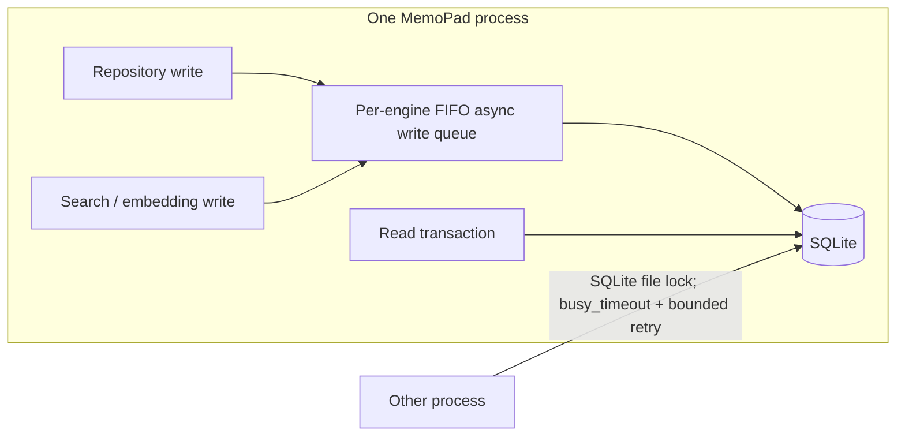

# Stage 0: Runtime and Windows Stability

**Status:** Complete
**Started:** 2026-09-27
**Source:** `memopad-rework.md` and the supplied Priority 0 checklist

## Changes in this stage

- Removed the leading UTF-8 BOM from the 149 affected Python source files.
- Added `.gitattributes` rules to normalize Python and Markdown files to LF.
- Added `check_utf8_bom.py` and wired it into `just lint`, which is the lint
  command run by the repository's CI workflow.
- Moved the POSIX file-count command off `asyncio.create_subprocess_shell` and
  into `asyncio.to_thread(subprocess.run, ...)`. The Windows path continues to
  use the async file scanner because Windows SelectorEventLoop does not support
  asyncio subprocesses.

## Stability mechanisms retained

The SQLite connection setup enables WAL, `synchronous=NORMAL`, and a
30-second `busy_timeout`. Every mutating repository transaction now opts into
a fair, per-engine async write queue in `db.scoped_session`; reads do not take
the queue, and independent SQLite engines do not block one another. The gate is
held through commit or rollback and released even when the transaction fails
or its task is cancelled while waiting.

CRUD, entity upsert, relation, alias, schema, project, conflict, embedding, and
search-index mutations use this write path. Existing bounded exponential
backoff retries remain in place for SQLite lock errors that survive the
in-process queue (for example, another process writing the same database);
search-index and embedding writes retain the longer bulk retry budget.
Background writers also share a process-wide concurrency semaphore. The
requested 10-second timeout is not applied because the existing 30-second
setting is more tolerant and is paired with bounded retry budgets.

The gate is acquired by `db.scoped_session(..., write=True)` and covers the
whole session transaction through commit or rollback. The audited write call
sites are:

- `repository.py`: generic CRUD inserts, updates, and deletes.
- `entity_repository.py`, `relation_repository.py`,
  `entity_alias_repository.py`, `observation_schema_repository.py`, and
  `project_repository.py`: specialized mutations and upserts.
- `search_repository_base.py` and `sqlite_search_repository.py`: search-index
  mutations and FTS index initialization.
- `embedding_service.py` and `conflict_service.py`: embedding table and
  observation conflict mutations.

Postgres calls may use the same `write=True` marker for shared repository code,
but the queue is only acquired for SQLite sessions. Database migrations and
schema initialization outside these repository session paths continue using
their existing engine-level coordination.

Windows loop policy is already set before event-loop-sensitive imports in the
MCP and CLI entrypoints. Git clone already uses `subprocess.run` in an executor
on Windows with a timeout; Windows file counting and incremental scanning use
the async scanner instead of asyncio subprocesses. These paths were verified
during the Stage 0 review and were not duplicated with a second policy layer.

The focused contention regression runs 32 concurrent SQLite sessions and
verifies both that every write completes and that no two in-process write
transactions overlap. A separate failure-path regression confirms a session
exception does not leave the queue locked.

## Baseline and validation notes

- Before edits, `src/memopad` contained 149 BOM-prefixed Python files.
- `python -m compileall -q src\memopad` completed before edits.
- Baseline write-budget and repository retry tests passed.
- Three unrelated MCP lifespan tests failed at baseline: two assign the
  removed `MemoPadConfig.cloud_mode` field, and one encounters multiple Alembic
  heads (`d7e8f9a0b1c2`, `j3d4e5f6a7b8`). These are outside Stage 0.
- After the changes, the BOM check and `compileall` passed; Ruff lint passed on
  the changed Python files; and the focused file-count, shared write-budget,
  repository retry, and SQLite write-contention tests passed (15 tests total).
- Follow-up completion of Task 0.2 added the per-engine FIFO SQLite write gate
  and write intent across the audited repository mutation paths. The
  contention and write regression selection passed (**144 tests**), Pyright
  reported **0 errors**, and Ruff lint passed. `ruff format --check` reports
  formatting differences in several touched modules; they were not
  mass-reformatted to avoid unrelated changes.
- `tests/sync/test_sync_service_incremental.py` could not reach its tests:
  fixture setup passes the unsupported `link_resolver` keyword to
  `SyncService.__init__` (21 setup errors). This is independent of file counting.
- Ruff's format check reports formatting differences elsewhere in the
  pre-existing `sync_service.py`; those unrelated sections were not reformatted.
- Pyright reports one pre-existing error at `sync_service.py:383` concerning
  exception values from `asyncio.gather`; it is outside the edited file-count
  method and was not changed here.
- Windows-specific entrypoint/clone behavior still requires CI validation.
